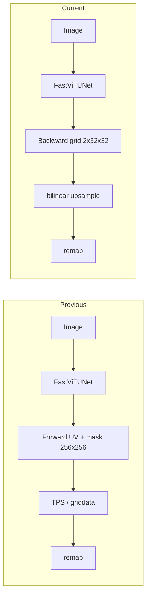

# Backward-map UVDoc model

Quality first, then speed. The mobile model no longer predicts a dense forward UV map that the phone inverts with TPS or `griddata`. It regresses a coarse backward map, and dewarping is one bilinear upsample plus one remap.

The old path predicted forward UV plus a mask at 32×32, bilinearly upsampled to 256×256. `vis_unet.py` inverted about 2500 points with TPS; the Kotlin app used up to 1200. That inversion amplified prediction noise (wobble and bent borders in `train_val2/`), cost cubic time in the number of points, and depended on a blurry 32×32 mask for its control points. The new output is 2 channels at 32×32 instead of 3 channels at 256×256.

A backward map has shape `(2, 32, 32)`. Entry `[:, i, j]` is the warped-image position of the flat-page point `(u = j/31, v = i/31)`. Channel 0 is `x`, channel 1 is `y`, both in the `align_corners=True` frame used by `grid_sample` and `cv2.remap`: `-1` is the center of the first pixel, `+1` the center of the last. Values may leave `[-1, 1]` when the page is cropped by the image border.

## Constraints that stayed in force

`downloads/` was emptied on purpose. The UVDoc zip is about 50 GB and Doc3D is larger, so neither was re-downloaded. Original Doc3D `bm` files and UVDoc `grid2d` were already gone. Ground truth for the maps on disk is an offline inversion of the stored forward UV at 256×256. One Doc3D `bm` partition was streamed from Hugging Face only to measure that inversion. It was not kept as a full download.

Doc3D (`dataset_doc3d`) and Inv3D (`dataset_inv3d`) already had their images locally. UVDoc (`dataset_unet`) did not have flat textures, warped textures, or edges, because those used to be read from `downloads/UVDoc_final`. Samples without those files train on the grid loss only.

## Phase 1: Data

**Done in code, not run on UVDoc textures.** [build_uvdoc_unet.py](build_uvdoc_unet.py) now writes `images/`, `masks/`, `bm/`, `flat_tex/`, and `warped_tex/` under `dataset_unet/<split>/`. The UVDoc backward grid comes from `grid2d` through `bm_from_point_grid`, which is exact. Warped textures fall back to remapping the flat texture with the forward UV. The train/val split is `hashlib.md5`, an 80/20 split, replacing `hash(img_id) % 5` which changed per process. Stale files from the other split are deleted. [generate_edges.py](generate_edges.py) reads UVDoc edges from `dataset_unet/<split>/flat_tex` and the masks, not from `downloads/`. This script was not executed. Running it would re-download UVDoc.

**Done and run.** [build_backward_maps.py](build_backward_maps.py) is separate from that builder. It inverts forward UV to `(2, 32, 32)` with multiprocessing.

- Mask eroded 3×3, then every second pixel inside the mask.
- `griddata` linear on `(u, v) -> (x, y)`.
- Doc3D applies `DOC3D_PAGE_AFFINE` first: `u' = 0.99604 u + 0.00688`, `v' = 0.99577 v + 0.00629`. Inv3D and UVDoc use identity.
- The outer grid ring is linearly extrapolated. Remaining holes are nearest-neighbour.
- Writes `bm/<id>.npy`. `--overwrite` recomputes, but a UVDoc sample that already has `flat_tex` is left alone, because that map would be the exact `grid2d` one.
- `--sanity N` saves `warped | GT dewarp | flat` under `bm_sanity/`. `--verify_doc3d N` compares against the streamed original `bm`.

Counts written: Doc3D and Inv3D 50190/50190 with the corrected inversion; UVDoc 20000/20000 with identity affine. UVDoc sanity images were skipped because `flat_tex` and `warped_tex` are missing. OpenCV "can't open" warnings during that run were the sanity step looking for those files. The maps themselves succeeded.

Against the original Doc3D `bm`, at 256 px: mean 0.308 px, median 0.301, p95 0.459, max 0.630. Interior about 0.21 px. The outer ring (124/1024 points) is about 1.18 px. Reconstruction L1 against `flat_albedo` is 0.0436 for the original map and 0.0483 for the corrected inversion. Without the affine, inversion was about 1.24 px and reconstruction L1 0.083. Extrapolating the ring without the affine made reconstruction worse. UVDoc inversion error against `grid2d` was never measured, because the raw grids are gone. Inv3D has no original `bm`.

**Safety net, done.** Each sample returns `has_flat` and `has_edges`. Reconstruction and edge losses are gated per sample. A missing texture does not train against a black image. Missing paths are not passed to `cv2.imread`.

Rough set sizes: UVDoc about 16048 train / 3952 val, Doc3D about 29600 / 7491 (`split.json`), Inv3D train 13125 and no val partition. Combined train set about 58700.

## Phase 2: Code structure

**Done.** The old `train_unet.py` was split:

| File | Role |
| --- | --- |
| [backward_map.py](backward_map.py) | Conventions, `resize_bm`, `bm_from_point_grid`, `invert_forward_uv`, `bm_to_dense`, `dewarp`, `bm_to_remap`, `bm_outline`, `grid_error_px` |
| [datasets.py](datasets.py) | `BackwardMapDataset` and UVDoc / Doc3D / Inv3D subclasses. Keys: `img`, `bm`, `flat`, `warped`, `flat_edges`, `warped_edges`, `has_flat`, `has_edges` |
| [models.py](models.py) | `FastViTUNet`, `MobileNetV3UNet` (legacy forward UV), `load_fastvit_unet` |
| [losses.py](losses.py) | `BackwardMapLoss` |
| [augment.py](augment.py) | Colour transforms and homography |
| [train_unet.py](train_unet.py) | Optimisation loop only |

`vis_unet.py`, `export_tflite.py`, and `count_unet_parameters.py` import `FastViTUNet` from `models.py`. `test_dataset.py` and `visualize_train_step_data.py` still import the old training API and were not ported.

The encoder is still FastViT-T8, about 4.43M parameters. Input is RGB in `[0, 1]` plus x/y coordinate channels, or those coordinates are appended inside the model when the tensor has 3 channels. Sobel edges are computed from RGB and concatenated, so the encoder sees 6 channels. The decoder stops at 32×32. `refine4` and the bilinear upsample to 256 exist only on the legacy forward-UV path. `load_fastvit_unet` drops leftover `refine4.*` keys.

**Head, changed from the plan.** The plan said a 2-channel `tanh`. The implementation predicts an offset on top of the identity grid, with the final convolution zero-initialised. `tanh` cannot represent a page that does not fill the frame.

## Phase 3: Augmentation

**Done.** Colour and noise stay in albumentations. Spatial augmentation is a random homography, not an albumentations affine on the label image. For a point `p` in the augmented image, `img_new(p) = img_old(H^-1 p)` and `bm_new = H(bm)`. Default probability 0.5 (`--aug_prob`), colour strength 0.2, noise std 0.2. `--no_spatial_aug` turns the homography off. Image-space keys are `img`, `warped`, and `warped_edges`.

On Doc3D val, ground-truth reconstruction L1 was 0.0644 before this augmentation and 0.0659 after.

## Phase 4: Loss and training

**Done.** `calibrate_loss_scales` is gone. It had pushed the curvature term to a scale around 1957.

`BackwardMapLoss` weights:

| Term | Weight | What it compares |
| --- | --- | --- |
| Grid | 1.0 | L1 on the 32×32 map. No mask: the grid covers the page. |
| Recon | 0.2 | L1 of `grid_sample(clean warped, upsampled prediction)` against the flat image. Gated by `has_flat`. |
| Edge | 0.2 | Same sampling of warped edges against flat edges. Gated by `has_edges`. |
| Curvature | 1.0 | L1 of second differences against the ground-truth second differences, not an absolute smoothness penalty. |

Recon and Edge ramp linearly over `--recon_warmup_epochs` (default 3). UVDoc currently has `has_flat = 0` and `has_edges = 0`, so only Grid and Curvature apply there. Doc3D and Inv3D use all four.

Training defaults: AdamW, lr `1e-3`, weight decay `1e-4`, cosine decay with `--warmup_epochs` 2, 120 epochs, EMA decay `0.999`, gradient clip `1.0`. The default batch in the script is 56. The run that produced the checkpoint used `--batch 96` (about 611 steps/epoch, about 3.1–3.2 it/s, about 3.2 min/epoch, so 120 epochs is about 6.5–7 h).

Checkpoints:

- `unet_bm_best.pth` — EMA `state_dict` only, written when UVDoc+Doc3D validation grid error improves. Inv3D does not affect selection.
- `unet_bm_best_last.pth` — model, EMA, optimiser, scheduler, scaler, epoch, and best error, written at the end of every epoch.

Resume with `python train_unet.py --epochs 120 --batch 96 --resume`. The cosine lambda is rebuilt from `--epochs` and the warmup, so those flags must match the interrupted run. The scheduler state does not store the lambda. Ctrl+C during the progress bar loses only the partial epoch. Interrupting during the save right after the validation line can corrupt `*_last.pth`.

## Phase 5: Evaluation

**Script done. Full before/after on the new checkpoint was not the thing that got run to completion in this session.** [eval_dewarp.py](eval_dewarp.py) reports mean grid error in pixels, reconstruction L1, and MS-SSIM on the val split, `--max_samples` 500 per dataset. `--legacy` loads `unet_best.pth` and inverts its forward UV+mask with `invert_forward_uv`.

The DocUNet benchmark (130 real photos) was left optional and was not downloaded.

Reference numbers, grid error at 256 px:

| | UVDoc | Doc3D |
| --- | --- | --- |
| Identity grid | ~45 px | ~45 px |
| Old forward-UV model vs corrected maps | 1.53 px | 1.78 px, recon L1 0.085, MS-SSIM 0.660 |
| Doc3D oracle (ground-truth map) | | MS-SSIM 0.755 |
| Doc3D label noise after the affine | | mean 0.308 px |

A useful grid error is about 0.5 px at 256, which is about 6 px on a 3000 px photo. Below about 0.4 px on Doc3D the metric is inside the label noise.

The 120-epoch run was stopped for testing around epoch 46. It was still improving and not overfitting:

| Epoch | Train grid L1 | Val grid error |
| --- | --- | --- |
| 7 | ~0.022 (~4 px) | 10.85 px (EMA still lagging) |
| 20 | 0.0186 | 1.65 px |
| 34 | 0.0149 | 1.39 px |
| 40 | | 1.34 px |
| 46 | 0.0132 | 1.29 px |

Learning rate at epoch 46 was about `6.95e-4`. An exponential fit `floor + amp * exp(-rate * epoch)` on epochs 20–34 gives a floor of 1.16 px (epoch 40 predicted 1.33, actual 1.34; epoch 60 about 1.22; epoch 120 about 1.16; residual RMSE 0.004). A fit that started at epoch 12 and floored at 1.39 px was too pessimistic. This curve does not reach 0.5 px. If the 0.31 px Doc3D label noise is independent, exact maps would move a 1.16 px model to about `sqrt(1.16^2 - 0.31^2) ≈ 1.12 px`. Rebuilding UVDoc textures so recon and edge losses turn on is the unquantified extra. `unet_bm_best.pth` (about 18 MB, 2026-10-19 10:02) is the best EMA from that run. The old `unet_best.pth` is still there for `--legacy`.

## Phase 6: Inference, export, app

**Done.** [vis_unet.py](vis_unet.py) upsamples the predicted grid and remaps. The final sample always comes from the sharp input, not from a resized intermediate. Axis alignment uses `minAreaRect` on the outline of the map border, so there is no mask head. Grid polylines are copied to a contiguous array before `cv2.polylines`.

[export_tflite.py](export_tflite.py) reparameterises the FastViT blocks once. Exact GELU becomes `tf.Erf`, which TFLite builtins do not have, so GELU is switched to the tanh approximation on a deepcopy after that reparameterisation. Reparameterising twice crashes: `RepMixer` no longer has `mixer`. Flex ops are off unless `--allow_flex` is passed. The verified fp16 file is about 8.42 MB, input `[1, 256, 256, 5]` float32 NHWC, output `[1, 32, 32, 2]` NHWC. Against PyTorch on the checked export: mean 0.010 px, max 0.030 px. The asset used by the app is `testapp/app/src/main/assets/model_fp16.tflite`, copied from `export_output/model_fp16.tflite`.

[ImageProcessor.kt](testapp/app/src/main/java/com/example/uvdoc/ImageProcessor.kt) no longer solves TPS. It builds a 256×256 NHWC float input (RGB in `[0, 1]`, plus x/y in `[-1, 1]`), reads 32×32×2 interleaved `xy`, bilinearly looks up the grid, then bilinearly samples the photo. Outside samples are black. Output is A4 portrait with the longer side equal to `max(photo width, photo height)`. `tensorflow-lite-select-tf-ops` was removed. Dependencies are `tensorflow-lite` 2.14.0, support 0.4.4, gpu 2.14.0, and `tensorflow-lite-gpu-api` 2.14.0. `tflite` is in `noCompress`.

Int8 post-training quantisation and QAT were not done. Latency was not the blocker.

**Phone, after export.** The emulator does not construct the GPU delegate, so it always runs XNNPACK. An S23 Ultra does.

- `GpuDelegate()` in `tensorflow-lite-gpu:2.14.0` needs `GpuDelegateFactory.Options`, which lives in `tensorflow-lite-gpu-api`. Without that artifact the phone crashed with `NoClassDefFoundError`. `catch (Exception)` does not catch that, because it is an `Error`. The fallback now catches `Throwable`.
- With the class present, the Adreno delegate can return a non-finite map. `NaN` fails every bounds comparison, so it reached `roundToInt` and threw `Cannot round NaN value`. A non-finite map now discards the GPU interpreter, reruns that image on XNNPACK, and keeps the CPU interpreter. Non-finite sample coordinates are drawn black.

The Studio build uses Gradle 8.13. AGP 8.13.2 calls `InternalProblems`, which Gradle 9.6 removed. Gradle 8.13 runs on Java 8–23. Android Studio's bundled runtime is Java 25, so the project JDK is the registered table entry `21` (OpenJDK 21.0.12) and `org.gradle.java.home` points at `/usr/lib/jvm/java-21-openjdk-amd64`. `gradleJvm` must be the table name `21`, not a filesystem path.

## Not in this plan

- Portrait input such as 384×272. That needs a dataset rebuild from raw images.
- Teacher distillation and real-photo pseudo-labels.
- A UVDoc 3D-grid auxiliary head. That needs raw `grid3d`.
